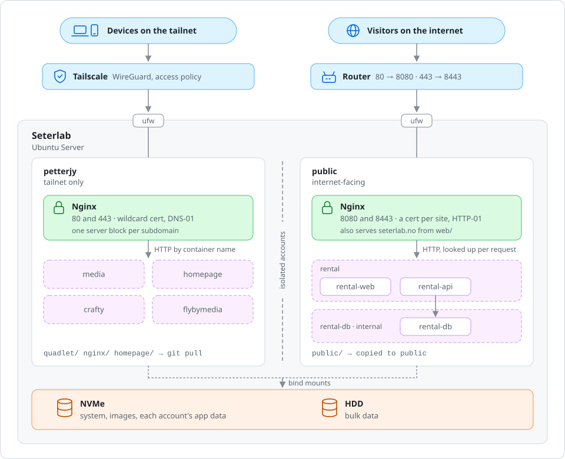

# Seterlab

Configuration for Seterlab, my home server: a Lenovo V50s SFF running Ubuntu Server 26.04 LTS. Services run as rootless Podman containers, defined as Quadlet units and started by systemd.

## Architecture

Every service runs as a rootless Podman container, with one `.container` file per service and one `.network` file per stack. The apps' own data, like databases and settings, lives on the server and isn't in this repo.

## Public and private services

The services are split between two Linux accounts:

| Account | Runs | Reached from | Config |
| --- | --- | --- | --- |
| `petterjy` | My private services | The tailnet only | `private/` |
| `public` | My public services| The internet | `public/` |

The repo keeps everything for its public services in `public/`. That folder is copied to a separate `public` account on the server, which can't read the private account's files or open connections to the host, the LAN or the tailnet.

## Networking

Each account has its own Nginx container. HTTP only redirects to HTTPS, and TLS ends at Nginx. The traffic from Nginx to the services is mostly plain HTTP, which never leaves the host. Each stack has its own Podman network, and Nginx joins them to reach each service by container name.

The private Nginx listens on ports 80 and 443. Its config is in `private/nginx/conf.d/`, with one server block per subdomain.

The public Nginx listens on ports 8080 and 8443, which the router forwards from ports 80 and 443 on the internet. Its config is in `public/nginx/conf.d/`. Each public site has its own certificate, checked over HTTP, so the account holds no DNS credentials.

## Tailscale

The private services are only meant to be reached over Tailscale. Public DNS points `*.seterlab.no` at the server's Tailscale address, which doesn't route outside the tailnet. The public sites have their own `A` records, pointing at the home IP, which override the wildcard.

The access policy, by role:

| Who | Can reach |
| --- | --- |
| Every member | Their own devices, and the server on ports 80 and 443 |
| Admins | SSH to the server, and the server as an exit node |

Grants target `tag:server` rather than an IP address.
